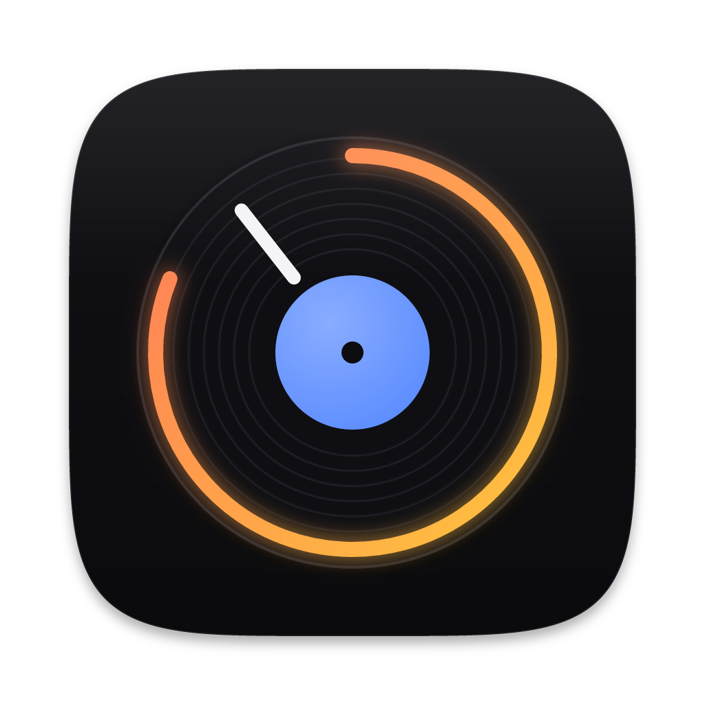
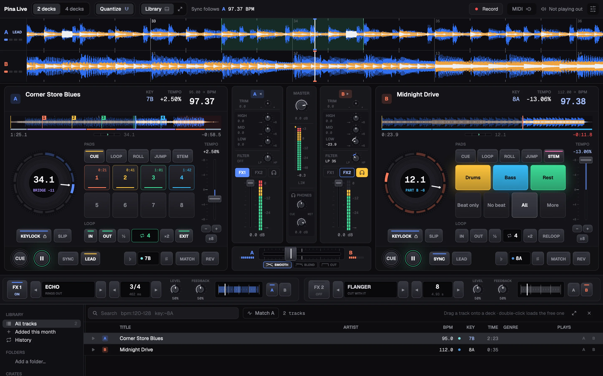
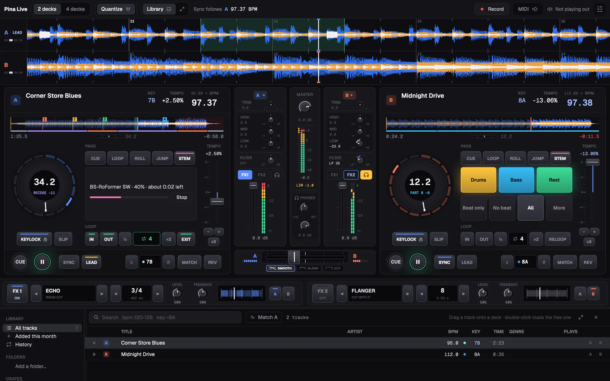
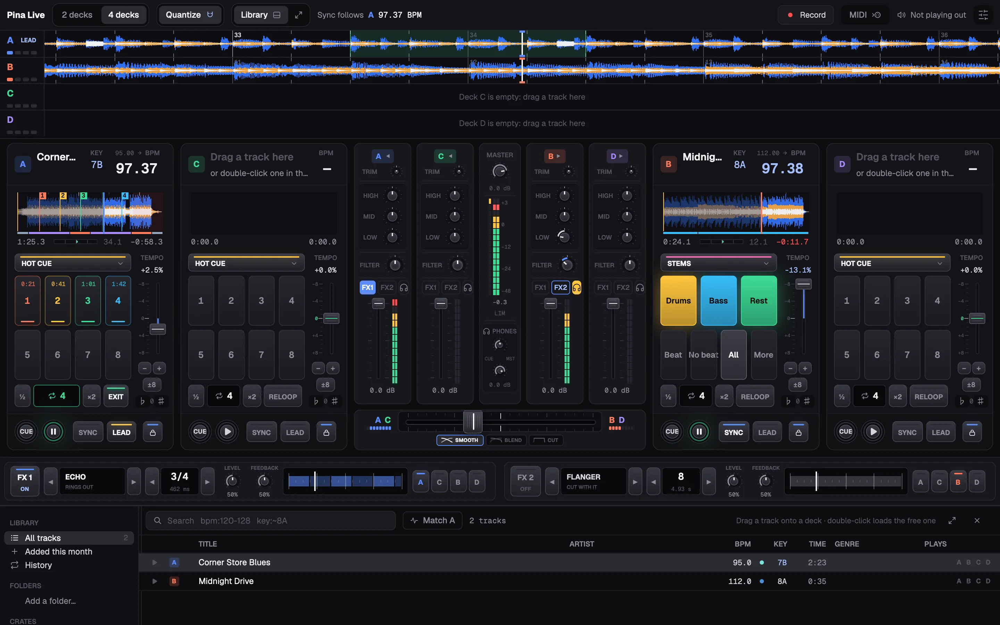
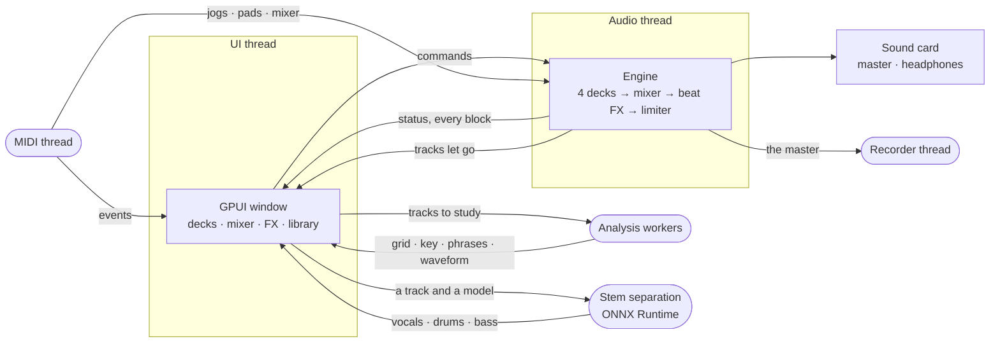

<p align="center"></p>

<h1 align="center">Pina Live</h1>

<p align="center">
  DJ software on <a href="https://github.com/manyeya/pina-studio">Pina Studio</a>'s engine.<br>
  Pina Studio's sister app: one makes the music, the other plays it out.
</p>

<p align="center">
  <a href="https://github.com/manyeya/pina-live/releases/latest"><b>Download</b></a> for macOS and Windows
  &nbsp;·&nbsp;
  <a href="https://manyeya.github.io/pina-live/"><b>Open in your browser</b></a>
  &nbsp;·&nbsp;
  <a href="https://manyeya.github.io/pina-studio/live/">Website</a>
</p>



Pina Live is written in Rust and drawn with [GPUI](https://www.gpui.rs). It doesn't
reimplement what Pina Studio already does well. Decoding, the song study that finds beat, bar,
key and phrases, the effects, the true-peak limiter and stem separation all come from Pina
Studio's engine. Pina Live adds what a DJ needs on top: decks that play as a player does, a
mixer, beat FX, a library made for finding the next track, and an audio thread that never
waits.

## Contents

- [Features](#features)
- [Get it](#get-it)
- [Playing](#playing)
- [Architecture](#architecture)
- [Development](#development)
- [Releases](#releases)

## Features

**Decks** (two or four):
- Keylock that follows the pitch fader every block, by a real-time stretch, and a key shift of
  ±12 semitones.
- CDJ cue (set it, and preview it while held), 8 hot cues, and quantized jumps that keep the
  beat.
- Auto loops from 1/4 to 32 beats, manual loop in and out (halve, double, move), rolls and beat
  jumps.
- Slip, reverse and censor, brake and spinback, and a platter or waveform you scratch with the
  mouse.
- Sync follows a leader (picked, or whichever deck has played longest) at half or double time
  when that's nearer. It lines up on the bar, then holds the beat.

**Mixer:**
- Per channel: trim, auto gain (every track to −10 LUFS), a three-band isolator EQ with full
  kills, a one-knob filter with resonance, and the channel fader.
- Crossfader assign, with three curves: smooth, blend and cut.
- Headphone cue with a cue mix, on its own outputs or split on one jack.
- The master goes through Pina Studio's true-peak limiter.

**Beat FX:**
- Two units, each on any channel, after the fader, so echoes and reverbs ring out when the fader
  comes down or the effect is switched off.
- Fifteen effects: Echo, Tape Echo, Dub Echo, Ping Pong, Reverb, Shimmer, Flanger, Phaser,
  Filter Sweep, Trans, Pitch, Pitch Echo, Crush, Tape Stop and Noise. Most of them are Pina
  Studio's own.

**Stems:**
- A track parts into vocals, drums, bass and the rest, using a separation model you add (Pina
  Live ships none).
- Mute any part, or go acapella, instrumental or drums only, with keylock on or off.
- Ask for vocals only or the beat only, and the quickest model you have does it.
- Tracks are parted as they load, so the stems are usually ready by the time you reach for them.

**Library:**
- Watched folders.
- Every track analysed in the background: tempo and beat grid, key and its Camelot number,
  phrases (intro, build, drop, outro…), loudness, and a three-band waveform.
- Cues and hot cues kept per track, crates and history.
- Search takes words plus `bpm:120-128`, `bpm:124`, `key:8A`, `key:~8A` (anything that mixes with
  it) and `rating:4`.
- Keys that mix with the leading deck are lit.

**Also:** recording the mix to WAV, MIDI controllers by MIDI learn, and laptop keys.

<table>
  <tr>
    <td></td>
    <td></td>
  </tr>
</table>

## Get it

| | What you get | Needs |
|---|---|---|
| **macOS** | `PinaLive-<version>.dmg`: open it and run *Install Pina Live* | macOS 13 (13.4 on Apple silicon). Apple silicon or Intel |
| **Windows** | `PinaLive-<version>-windows-x64-setup.exe`, a per-user installer (no administrator), or the zip | Windows x64 |
| **Browser** | [manyeya.github.io/pina-live](https://manyeya.github.io/pina-live/). Drop tracks onto the page, or try the demo songs | A current Chrome or Edge |

Every release is on the [releases page](https://github.com/manyeya/pina-live/releases).

The builds aren't notarized or code-signed yet:
- **macOS:** if it won't open, go to System Settings › Privacy & Security › Open Anyway.
- **Windows:** if SmartScreen stops it, choose More info › Run anyway.

Stems use the models you've added to Pina Studio (Settings › Stem models): Pina Live reads the
same folder. You can also download a model from Pina Live's own Settings.

## Playing

| Deck A | Deck B | |
|---|---|---|
| Q | P | play / pause |
| A | L | cue (held) |
| Z | , | sync |
| W | O | 4-beat loop |
| 1–4 | 7–0 | hot cues 1–4 (held) |

- **Library:** ⇧← and ⇧→ load the selected track onto A or B; ↑ and ↓ move through the library;
  ⌘F searches.
- **Window:** ⌘4 switches between two and four decks; ⌘L shows or hides the library; ⌘⇧L
  fills the window with it; ⌘= and ⌘− zoom the waveforms.

**MIDI.** Click **MIDI** in the top bar, click a control on screen, then move it on your
controller. For a jog, touch it and then turn it. Settings › Controllers lists every mapping:
flip one that runs backwards, or remove it.

## Architecture

### Overview



The audio thread is the heart of the app, and it's kept simple: it never waits, takes no
locks and allocates nothing. Everything else talks to it through lock-free ring buffers
([`rtrb`](https://crates.io/crates/rtrb)):
- **Commands in:** from the window, and from MIDI on a ring of its own, so scratching never
  waits for a frame to be drawn.
- **Status out:** a snapshot of every deck and meter, every block.
- **Trash out:** tracks a deck has let go, sent back so the window's thread frees them.

### Workspace

| Path | Crate | What's there |
|---|---|---|
| `crates/engine` | `pina-live-engine` | The engine with no window: decks, mixer, FX, output, recording, library, analysis, stems |
| `crates/app` | `pina-live` | The application: the GPUI window, controls, MIDI, settings, background work, the web glue |
| `crates/installer` | `pina-live-installer` | *Install Pina Live*, the animated installer on the Mac's disk image |
| `web/` | | The browser build's page, its Web Worker and the demo songs |
| `scripts/` | | Bundling and the disk image (`release-mac.sh`), the Windows installer (`windows/`) |
| `.github/workflows/` | | macOS, Windows and Web builds |

### Threads

| Thread | What runs there | How it talks |
|---|---|---|
| UI | The GPUI window: input, layout, drawing; the library and settings | `Remote`: commands in, status out |
| Audio | `Engine::process`, one device block at a time | Ring buffers only |
| MIDI | Controller input, looked up in the mappings | Its own command ring to the engine; events to the window |
| Analysis | `analyze()`: decode, then Pina Studio's study. Half the cores, 1 to 6 workers | A queue the decks can jump (a track just loaded goes first) |
| Stems | Overlapping pieces of a track, each on its own ONNX Runtime session | Progress in an atomic; a channel when done |
| Recorder | The master to a 24-bit WAV | A ring from the audio thread, so the disk never holds it up |
| Loading | A track decoded and brought to the engine's rate | GPUI's background executor |

### The audio path

Each block from the sound card runs through these stages, in order:

1. **Decks.**
   - A deck plays in steps of 64 frames.
   - A jump (a cue, a loop's end, a beat jump) lands at the start of a step and crossfades over
     it, so nothing clicks.
   - Keylock is [Signalsmith Stretch](https://signalsmith-audio.co.uk/code/stretch/) reading
     ahead by its latency. Two stretchers take turns across a jump: the outgoing one plays on
     while the incoming one starts.
   - Slip keeps the track playing silently underneath, to come back to.
2. **Sync.**
   - A leader sets the tempo.
   - Each deck with sync on takes it, at half or double time if that's nearer its own.
   - It lands on the leader's beat with a jump when it starts, then holds there with a
     correction on its speed too small to hear.
3. **Mixer.**
   - Per channel: trim and auto gain, the isolator, the filter, the fader, then its side of the
     crossfader.
   - Cue feeds the headphone mix.
4. **Beat FX**, after the fader, timed in beats of the leading deck. Their tails ring out after
   they're switched off.
5. **Master**, through Pina Studio's true-peak limiter.
6. **Output.**
   - The master goes to one pair of outputs and the headphones to another, as a DJ controller
     or audio interface has them.
   - Split mode puts both on one pair instead: the master in the left ear, in mono, and the cue
     in the right.

`cargo run --release -p pina-live-engine --example bench` times the heaviest load: four
keylocked decks with stems, and both FX units on every channel. It takes about 6% of one core
on an M-series Mac.

### Library and analysis

`analyze()` decodes a track and runs Pina Studio's song study on it, which yields:
- the tempo and beat grid,
- the key and its Camelot number,
- phrases, each with its energy,
- loudness,
- a waveform of three bands (lows, mids and highs) at 150 columns a second.

Raising `analyze::VERSION` has every track studied again.

Everything is kept under one folder: `~/Library/Application Support/Pina Live` on macOS,
`%APPDATA%\Pina Live` on Windows, or `PINA_LIVE_HOME` if it's set.

| File | Holds |
|---|---|
| `library.json` | Folders, tracks, tags, analysis, cues, crates, history |
| `waves/<id>.plw` | Each track's waveform, packed |
| `stems/<id>/` | Each track's stems, at 16 bits |
| `settings.json` | Audio device and outputs, layout, preferences |
| `midi.json` | Controller mappings |

Recordings go to `~/Music/Pina Live/Recordings`.

### Stems

Stems come from Pina Studio's separation (`pina_engine::separate`), using whichever models are
in Pina Studio's models folder.
- **Speed:** one ONNX Runtime session keeps only a few cores busy. So `part.rs` cuts the track
  into overlapping pieces, parts each on its own session and thread, and crossfades them back
  together in the middle of each overlap, far from the pieces' edges.
- **Exact sum:** vocals, drums and bass are kept at 16 bits. The rest (the melody) is whatever
  the mix has left once they're taken out, so all four together are exactly the track.

### The interface

The window is GPUI, laid out to fit whatever size it's given:
- **Layout.** `layout.rs` sizes the waveforms, decks and library. When the window is short, the
  waveforms give way first, then the decks, but never below their smallest. The mixer sizes its
  faders first, then its knobs.
- **Detail.** `hw.rs` draws the hardware: lit keys, the jogs and the displays. `detail.rs`
  prints what every control is set to, as a mixer's scales do.
- **Waveforms.** Each band is drawn as one shape, two triangles per column, not as quads. That
  keeps a frame cheap at any width.
- **Layout test.** The window reports where its panels and rows end up (`probe.rs`). The
  `layouts_fit` test lays it out at ten window sizes and checks that nothing spills, the
  columns line up, and every fader keeps a usable share of the space.

### In the browser

The web build is the same app compiled to WebAssembly and drawn by GPUI's web platform. Where a
browser can't do what the desktop does, it does it another way:

| | Desktop | Browser |
|---|---|---|
| Drawing | GPUI: Metal on macOS, Direct3D 11 on Windows | GPUI on WebGPU |
| Sound | cpal: Core Audio, WASAPI | cpal: Web Audio, started on the first click |
| Keylock | Signalsmith Stretch (C++) | `wsola.rs`: WSOLA in Rust, with a fixed latency like Signalsmith's |
| Tracks | Watched folders | Files dropped or picked, held in memory (`memfs.rs`) |
| Decoding and analysis | Threads | Two Web Workers running the same module (`web.rs`, `web/worker.js`): one decodes for the decks, one analyses |
| Library | Kept between runs | Kept for the session |
| Stems and recording | Yes | Desktop only |
| MIDI controllers | Yes | Not tested yet |

A browser page has one thread, which draws, plays and listens. Anything slow done on it stops
all three, so on the web the decoding and analysis run in the workers. The engine itself is
unchanged.

### Pina Studio's engine

`pina-engine` is a git dependency, pinned to a commit in the workspace `Cargo.toml`. Pina Live
uses it for:
- decoding,
- resampling,
- the song study,
- the effects,
- the limiter,
- stem separation and its model catalog.

Pina Studio's plugin hosting, MP3 export and Rubber Band are left out of web builds.

## Development

Needs the Rust stable toolchain (edition 2024). On Windows, add the MSVC build tools. For the
web build, add the `wasm32-unknown-unknown` target and the `wasm-bindgen` CLI at the version
`Cargo.lock` has.

```sh
cargo run --release -p pina-live        # run it
cargo test --workspace                  # the engine offline, the window as a person uses it
scripts/bundle.sh                       # build Pina Live.app and install it in /Applications
```

Screenshots, drawn headless by the Metal renderer (macOS):

```sh
PINA_LIVE_SHOT=out PINA_LIVE_SHOT_TRACKS="a.mp3|b.mp3" cargo test -p pina-live shots -- --ignored
# PINA_LIVE_SHOT_PAGE=four|parting|full|settings|…   PINA_LIVE_SHOT_STEMS=<folder of stems for B>
```

The browser build:

```sh
cargo build --release --target wasm32-unknown-unknown -p pina-live
wasm-bindgen --target web --no-typescript --out-dir web/pkg \
  target/wasm32-unknown-unknown/release/pina-live.wasm
cd web && python3 -m http.server        # then open http://localhost:8000
```

## Releases

Every push to `main` runs three workflows. Tagging `vX.Y.Z` also puts their builds on that
tag's GitHub release.

| Workflow | Does |
|---|---|
| **macOS** | Tests, then `scripts/release-mac.sh`. The result is a universal `PinaLive-<version>.dmg` with *Install Pina Live* on it. It's signed ad hoc, or with a Developer ID if `PINA_SIGN_ID` is set. |
| **Windows** | Tests, a release build, then an Inno Setup installer (`scripts/windows/pina-live.iss`) and a zip |
| **Web** | Builds the WebAssembly and publishes `web/` to [GitHub Pages](https://manyeya.github.io/pina-live/) |

To release:
1. Bump `version` in the workspace `Cargo.toml`.
2. Tag the commit `vX.Y.Z` and push the tag.

Pina Live's [page on the Pina website](https://manyeya.github.io/pina-studio/live/) picks up the new
downloads by itself.
